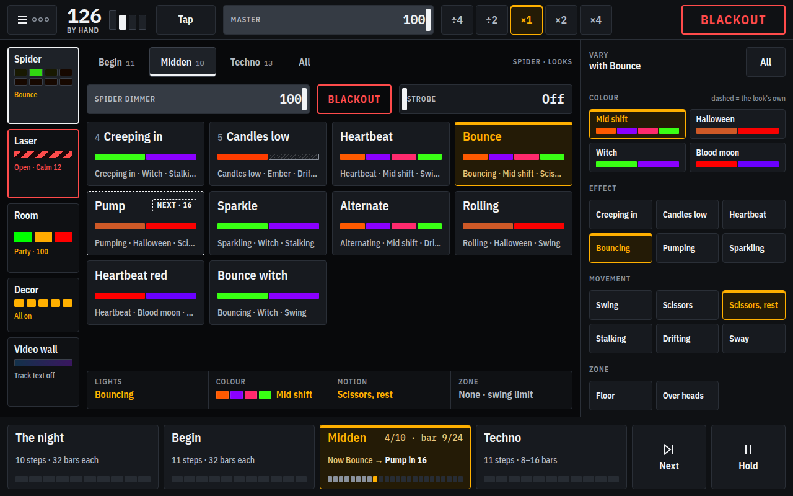
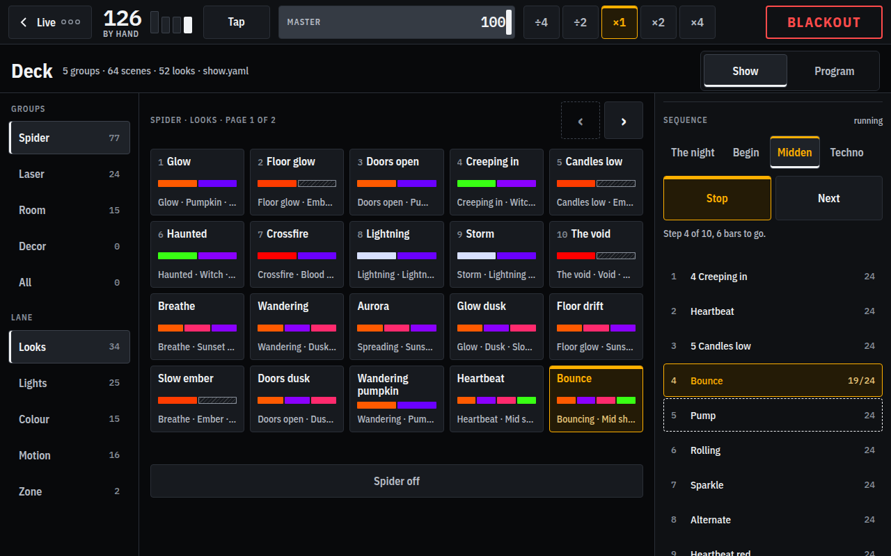
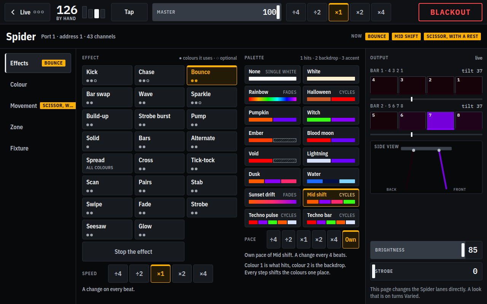
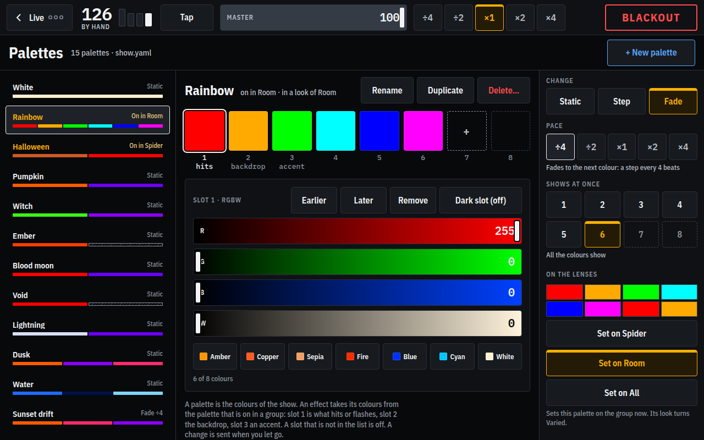
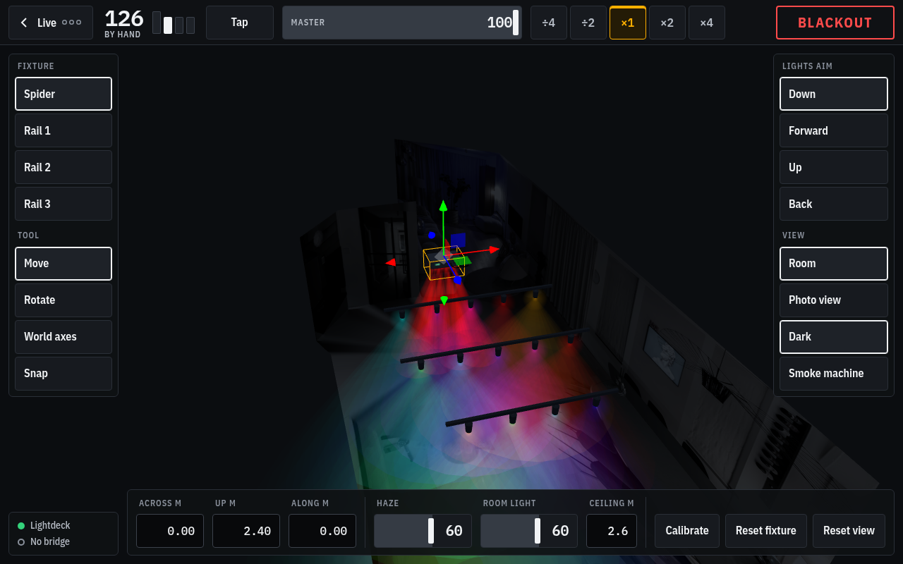
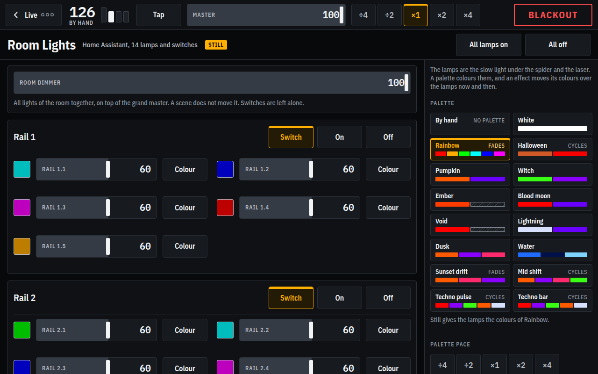
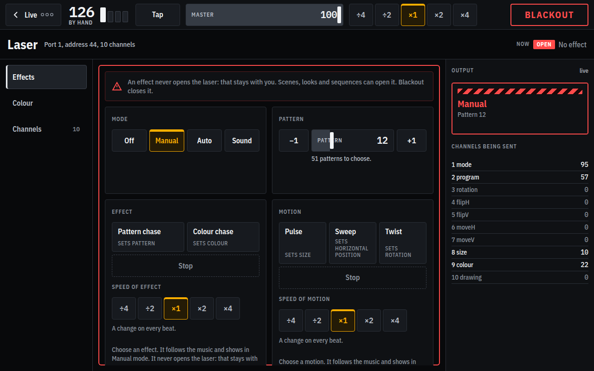

# Lightdeck

A self-built lighting console for small parties. It drives DMX fixtures through a
Nicolaudie Light Rider LR512 interface, from a web page on a tablet, without Daslight or
the Light Rider app. The lamps and switches of the room, in Home Assistant, are driven from
the same console as slow scenery under the DMX fixtures.



> **Early work in progress.** Lightdeck is built for one home event with one set of
> hardware. It works on that hardware and has been tested nowhere else. Settings, the API
> and the show file change without notice. Expect to read code.

## What works and what does not

| Part | State |
|---|---|
| Live DMX to the LR512, from Linux | Works on real hardware, through an Android phone as bridge |
| Fixture pages for manual control | Work, for the two fixtures below |
| Beat-synced effects, tap tempo, blackout | Work: twenty-three light effects and seven motion effects for the spider, five effects for the laser |
| Palettes: the colours of the show, apart from the effects | Built, not yet tested on the real fixtures |
| Scenes and looks: store what the fixtures do, recall it | Built, not yet tested on the real fixtures |
| Grand master, swing limits and zones of the spider | Built, not yet tested on the real fixtures |
| Tempo from rekordbox, through rkbx_link (OSC) | Built. Tried against a stand-in for rkbx_link and with real rkbx_link data arriving; has not driven the real fixtures |
| Video wall (Dreamscape Player): the track text and playing its library from the tablet | Built. Jeroen has seen the artist and title on the wall; the playback controls were tried against a stand-in player only |
| Simulator: the spiders and the lamps of the room in 3D (a rail per zone, every lamp moved along its rail), a living room, a smoke machine | Works in a desktop browser, never compared with the real spider |
| Home Assistant lamps and switches: one fixture, "Room Lights", with zones, scenery effects and a dimmer | Built. Tried against the real Home Assistant for the login, the lamps and a soak of the first throttle, and against a stand-in; not yet soaked again, and not on a tablet. See [docs/hass-fixtures-plan.md](docs/hass-fixtures-plan.md) |
| Sequences: the looks of the groups changing by themselves on the bars (the parts of the evening) | Built, written in the show file by hand, started on the deck or the tablet. Not yet tested on the real fixtures |
| Tablet page (`/tablet`), as a browser page or as an Android app | Built, run in desktop Chrome only; the app builds and has not run on a tablet |
| Crossfades, holds | Not built, see [docs/show-design.md](docs/show-design.md) |
| Art-Net, sACN | Not built |
| Running in a container | A `Dockerfile` is there, but this is not a supported way to run it yet |

Fixtures it knows:

- **Spider**: a moving head with 8 RGBW LEDs on two motorised bars, in its 43-channel
  mode.
- **Alien 500 mW RGB laser**, 10 channels.
- **Room Lights**: the lamps (lights) and switches that Home Assistant drives, as one fixture
  with zones, like the two bars of the spider. They follow the palettes, the grand master and
  the blackout, and have a dimmer of their own.
- **Decor**: what is part of the set and not of the lighting: two UV lamps on the symbols of a
  cabinet (switches, through Home Assistant) and three WLED strips in white dryer hoses, "the pipes". Lightdeck
  draws the effects of the pipes itself, as if a liquid flows through them, in the colours of the show's palettes
  and at a speed that follows the bpm, and can link the three into one long pipe. On their own tab of the
  tablet page: on and off apart or together, brightness, and for a pipe its effect and palette. No scene, look
  or sequence touches them. Each can follow the blackout of the console or not, which is set on the tab while
  the show runs. See [The decor](#the-decor-uv-lamps-and-pipes).

Other fixtures need a profile of their own, see [Adding a fixture](#adding-a-fixture).

## The pages

The tablet page above is what you play on. The rest is for setting up and for trying things.
These were made from a lightdeck running without a bridge and against the simulated Home
Assistant, so no real fixture or lamp was driven.

| | |
|---|---|
| [](docs/screenshots/deck.png) **Deck** (`/deck`): the groups, their looks and scenes, and the sequences | [](docs/screenshots/spider.png) **Spider** (`/fixtures/spider`): effects, palettes, movement and zones, with the lenses and bars as they are sent |
| [](docs/screenshots/palettes.png) **Palettes** (`/palettes`): the colours of the show, apart from the effects | [](docs/screenshots/simulator.png) **Simulator** (`/simulator`): the spiders and the lamps of the room in 3D, drawn from the bytes that are sent |
| [](docs/screenshots/room.png) **Room Lights** (`/fixtures/room`): the lamps and switches in Home Assistant, in zones | [](docs/screenshots/laser.png) **Laser** (`/fixtures/laser`): mode, pattern, effects and the channels that are sent |

## How it works

```
tablet ──HTTP──▶ Lightdeck ──WebSocket──▶ Android bridge ──Wi-Fi──▶ LR512 ──DMX──▶ fixtures
                 (Node)   │               (phone)
                          ├──WebSocket──▶ Home Assistant ──Zigbee──▶ lamps, UV switches
                          ├──DDP (UDP)──▶ WLED strips (the pipes)
                          └──HTTP───────▶ Dreamscape Player (the video wall)
```

The LR512 speaks a closed protocol: live DMX is authenticated and encrypted, and the code
for it lives in the vendor's native library, which exists for Android only. Lightdeck
does not reimplement it. A small Android app loads the vendor library, opens the LR512
and serves a WebSocket; lightdeck sends whole DMX universes to that socket. What was
found out about the protocol is in
[docs/lr512-protocol-findings.md](docs/lr512-protocol-findings.md).

The lamps go the other way round. Lightdeck talks to the WebSocket API of Home Assistant
(`call_service` on `light.` and `switch.` entities) and Home Assistant talks Zigbee. A Zigbee
mesh takes a few commands per second and not forty frames, so the lamps are the slow layer: a
lamp gets a new command only when its last one was answered, no more than 4 are on the way, and
the newest one wins. Lightdeck starts without Home Assistant, and the DMX side never waits for
it.

The tempo is set by hand (slider, nudge, tap) or follows rekordbox. For that,
[rkbx_link](https://github.com/grufkork/rkbx_link) runs on the computer with rekordbox and sends the bpm, a
trigger on every beat and the position as OSC over UDP to lightdeck (default port 4460).
With the tempo on Rekordbox the bpm follows it and the beats are placed by the triggers;
when the beats stop, the effects idle. Set `osc.enabled`, `osc.source = 0.0.0.0:4450`,
`osc.destination = <computer>:4460` and turn on the messages `master/beat/trigger`,
`master/time` and, for the track text and Idle in breakdown, `master/track/title`,
`master/track/artist` and `master/phrase`. `pnpm rkbx-monitor` shows what arrives.

The three WLED strips do not go through Home Assistant: lightdeck draws every frame itself, 40 a
second, and sends the pixels straight to each strip over DDP (UDP port 4048). Home Assistant only
tells lightdeck where the strips are. See [The decor](#the-decor-uv-lamps-and-pipes).

The track that plays can also go to a video wall (the Dreamscape Player), and its library is
played from the tablet: see [The video wall](#the-video-wall).

## What you need

- A Light Rider **LR512**, on your Wi-Fi (leave it out to try lightdeck with the simulator).
- An **Android phone** on the same Wi-Fi. Emulators and Waydroid sit behind NAT and do
  not find the LR512.
- The **Light Rider APK**, which you have to get yourself. It is Nicolaudie's software
  and is not part of this repository.
- For the lamps: **Home Assistant** with the lights and switches in it, and a long-lived
  access token (your profile page in Home Assistant).
- A computer with **Node 22** and **pnpm**. Lightdeck is developed on Linux.
- To build the bridge: JDK 17 or newer, the Android SDK build-tools, `adb` and
  `baksmali`.

## Getting started

### 1. Build and install the bridge

Put the Light Rider APK in the root of the repository as `lightrider_classic.apk`, then:

```bash
cd android-bridge
./build.sh
adb install -r bridge-gate.apk
```

Open **Lightdeck LR512 Bridge** on the phone and keep it on screen. When the lamp
"LR512" is green the device is open. The log on the screen says where lightdeck has to
connect to, for example `ws://192.168.68.101:9010`.

The bridge uses the package name of the Light Rider app, so the two cannot be installed
next to each other. Details, the wire protocol and the known limits are in
[android-bridge/README.md](android-bridge/README.md).

### 2. Start lightdeck

```bash
git clone https://github.com/jeroenpeeters/lightdeck.git
cd lightdeck
corepack enable
pnpm install
pnpm dev --bridge ws://<phone-ip>:9010
```

No phone or LR512 at hand? Leave `--bridge` out and open `http://localhost:8080/simulator`: it
draws the spiders in 3D from the bytes lightdeck sends. Move and rotate them with the mouse
or a finger. With a bridge it shows the same as the real fixtures get.

### 3. Add the lamps (optional)

Copy `rig.example.yaml` to `rig.yaml` where lightdeck starts and put your own entities in it:
the lamps, and zones of lights, like the bars of the spider. Then give lightdeck the address and
the token, in the environment or in a `.env` file next to `rig.yaml` (it is in `.gitignore`;
`pnpm dev`, `pnpm start` and `pnpm lamp` read it):

```
HASS_URL=http://<home-assistant>:8123
HASS_TOKEN=<long-lived access token>
```

Try one lamp before you rely on them, and check what Home Assistant says about it:

```bash
pnpm lamp light.<name> --list                       # state and colour modes
pnpm lamp light.<name> dimmer=50 red=100 fade=2
pnpm lamp light.a light.b light.c --soak 3          # fade them through colours for 3 minutes, then report
```

Without `rig.yaml` there are no lamps and nothing asks Home Assistant.

To program or rehearse without touching the real lamps, start lightdeck with `--hass-simulate`
(or `HASS_SIMULATE=1`). The room then runs against a Home Assistant that lives in lightdeck, with
no URL or token: the lamps answer at about the pace of a real Zigbee mesh, and the status bar
says "Home Assistant simulated" in amber.

### 4. Open the console

Go to `http://<computer-ip>:8080` on the tablet. The console has:

- **Deck**: the groups and the lanes (looks, lights, colour, motion, zone) as a list, the keys of
  the chosen one, and the sequences at the side. Show mode presses them; Program mode stores,
  renames and deletes scenes, looks and groups. Set the fixtures on their pages, store that as a
  scene, and get it back with one press.
- **Palettes**: the colours of the show, apart from the effects. A list of up to eight
  colours (or off), static or cycling.
- **Tablet** (`/tablet`, the old `/moods` goes there): the page for a tablet at the side of the
  dance floor, built after the design in [design/](design/HANDOFF.md) (every page has it: a lighting-console look,
  dark, IBM Plex, a rail of the groups with what each shows right now), with few, big controls: tap the tempo, the master and its speed, the parts of the
  evening (sequences, with Next and Hold, which freezes a part and lets it go on when pressed again), the looks of a group by mood with a tray under them to
  vary the look (palette, effect, movement, zone), a dimmer and a blackout for each group in
  the same place on every tab (the laser has no dimmer, so there it rests) and a switch per rail for
  the room, the blackout of everything, the state of the bridge, the LR512 and Home Assistant, and last a tab
  Video wall: play what the player has (playlists, videos, effects, texts), its blackout, and the
  text of the track.
- **Video wall** (`/videowall`): the same video wall controls on a page of their own.
- **A page per fixture**, to set it by hand and to start an effect. The page of the room has a
  fader and a colour per lamp, the zones, the switches, the dimmer of the room, the palettes
  and the scenery effects.
- **The tablet as an Android app.** On Android, Chrome does not install the page without https. The small app in [android-tablet/](android-tablet/README.md) is just a full-screen window on the tablet page: `./build.sh`, then `adb install -r lightdeck-tablet.apk`.
- **Install the tablet page as an app.** `/tablet` has a manifest and icons, so that on the home
  screen of the tablet it opens full screen, without the bar of the browser. On an iPad: Share, Add
  to Home Screen. Android and Chrome only offer to install it on an https address or on localhost,
  not on `http://<ip>:8080`: there the menu has only "Add to Home screen", which makes a shortcut. The
  page does not work offline, but when lightdeck cannot be reached it still opens and says so. Without
  https (or the Chrome flag `unsafely-treat-insecure-origin-as-secure` set to the address of the
  computer), the tablet page has a **Fullscreen** key in the top row that hides the bar of the
  browser while the page is open.
- **Simulator** (`/simulator`): the 3D view.
- On every page: the bpm with beat lamps and Tap, the master, the speed of the effects and the
  blackout, and a key to the live page. The tempo source (by hand or Rekordbox), the nudge and the
  state of the links (bridge, LR512, Home Assistant) are in the menu of the tablet page.

## Settings

As a flag, or as an environment variable.

| Flag | Environment | Default | What |
|---|---|---|---|
| `--bridge` | `LR512_BRIDGE_URL` | none | Where the bridge is: `ws://<phone-ip>:9010`. Without it nothing goes to an LR512 and the simulator is the output |
| `--universe` | `SPIDER_UNIVERSE` | `0` | Universe of the spider, counted from 0. An LR512 has one usable universe, which is 0 |
| `--address` | `SPIDER_ADDRESS` | `1` | DMX start address of the spider |
| `--laser-address` | `LASER_ADDRESS` | `44` | DMX start address of the laser, or `none` to run without it |
| `--laser-universe` | `LASER_UNIVERSE` | the spider's | Universe of the laser |
| `--show` | `SHOW_FILE` | `show.yaml` | The show file |
| `--hass` | `HASS_URL` | none | Home Assistant: `http://<host>:8123` (or `ws://<host>:8123/api/websocket`). Needed when `rig.yaml` has lamps |
| | `HASS_TOKEN` | none | A long-lived access token for Home Assistant. Environment or `.env` only, never a flag |
| `--hass-simulate` | `HASS_SIMULATE` | off | Run the lamps against a simulated Home Assistant: no real lamp is touched, no URL or token needed |
| `--videowall` | `VIDEOWALL_FILE` | `videowall.json` | The settings of the video wall, written by its page. It holds the PIN of the player, so it is in `.gitignore` |
| `--decor` | `DECOR_FILE` | `decor.json` | How the pipes are put together: linked or not, their order and which are mounted reversed. Written by the page `/decor`; it says how the set is built, so it belongs in git |
| `--rig` | `RIG_FILE` | `rig.yaml` | The rig file, with the lamps of the room. No file, no lamps |
| `--max-fps` | `MAX_FPS` | `25` | The most DMX frames per second to send, 1 to 60 |
| `--lead-ms` | `LEAD_MS` | `0` | How far ahead of the beat the output is made |
| `--tempo` | `TEMPO_SOURCE` | `manual` | Who sets the tempo at the start: `manual` or `rekordbox` (the OSC of rkbx_link) |
| `--rkbx` | `RKBX_PORT` | `4460` | The UDP port for the OSC of rkbx_link, or `off`. `pnpm rkbx-monitor` shows what arrives |
| `--port` | `PORT` | `8080` | Port of the console |
| `--host` | `HOST` | `0.0.0.0` | Address to listen on |

Which DMX fixtures there are is set in `src/index.ts`. For now that is one spider and one
laser. The lamps are in `rig.yaml`.

## From the command line

Without the console, to try a fixture or an address:

```bash
pnpm spider <phone-ip> dimmer=100 red=100
pnpm spider --list                                        # the channels by name
pnpm laser <phone-ip> mode=manual program=pattern:12
pnpm laser --list
node tools/lr512-send.mjs <phone-ip> 0 set 6=255 7=255    # raw channels
pnpm lamp light.bar dimmer=50 red=100 fade=2              # a Home Assistant light, see step 3
pnpm pipes <strip-ip> --effect flow --palette water --bpm 126 --seconds 20   # play a pipe effect on one WLED strip

# photograph the laser at its settings (the phone app in android-camera/ looks at the wall)
pnpm laser-survey pilot --camera <camera-phone-ip> --bridge <bridge-phone-ip> --pattern 26 --distance 3
```

Each of the DMX ones sends one fixture and zeros for the rest of the universe, so other
fixtures on it go dark. `pnpm pipes` needs neither lightdeck nor Home Assistant: it sends the pixels
to the strip itself, shows how late its timer was and sends black at the end.

## The show file

Palettes, scenes, looks, moods, sequences and the swing limits of the spider are kept in one YAML file, which the deck writes and which you
can edit by hand. Lightdeck watches the file. A file with a mistake never replaces the show
that is running: the deck says what is wrong and keeps the show as it was.

```yaml
palettes:
  sunset:
    label: Sunset
    colours: ['#ff4a00', off, '#ffb000']   # #rrggbb, #rrggbbww (with white) or off
    mode: cycle                            # static | cycle
    change: fade                           # step | fade
    speed: 0.25                            # ÷4 .. ×4: one step per bar at 0.25
groups:
  spider:
    label: Spider
    fixtures: [spider]
    scenes:
      chase:
        label: Chase
        type: lights
        fixtures:
          spider: { levels: { dimmer: 1 }, effect: { id: chase, speed: 1 } }
      wide:
        label: Wide
        type: motion
        fixtures:
          spider: { levels: { tilt1: 0.2, tilt2: 0.8 }, motion: { id: scissor, speed: 0.5 } }
    looks:
      drop:
        label: Drop
        lights: chase
        colour: { palette: sunset, speed: 0.25 }
        motion: wide
```

Colours are palettes, and no effect names a colour: a light effect says how much of the
first, second and third colour of the palette every lens gets, a motion effect moves the
bars, and any of them goes with any other. An empty colour is a dark lens. A scene is of
the type `lights`, `motion` or `zone` and keeps and sets only the properties of that type
(a zone is the window of tilt of each bar that the motion effects work inside). A group
has one scene of each type on and one palette, so a palette can be pressed under a chase
that is running. A look sets a scene of lights, a palette, a scene of motion and a scene of
zone together. A group can list `moods` (scenes and palettes that go together), a look says
which mood it is in, and the tablet page shows the looks of a group by mood.
A fixture that a scene does not name has those properties at rest, and off is the lights.
The laser does not use the palettes: it has up to three colours of its own.

A `limits:` entry per fixture (the spider's tilt, a `{ min, max }` per bar) keeps a bar from
going beyond that, whatever sets it. The room lamps are in groups, scenes and looks like any
fixture, and the scenery effects (`still`, `rotate`, `shuffle`, `zones`) move the colours of
the palette over them about once a minute.

## Sequences

A sequence changes the looks of the groups by itself, on the bars of the tempo. The spider can go
through its looks while the room keeps its own. It is written in the show file, and started and
stopped on the deck, where a panel of sequences shows the steps and where it is. The tablet page
has a key per sequence, as the parts of the evening, with Next and Hold.

```yaml
sequences:
  night:
    label: The night
    steps:
      - { bars: 32, looks: { spider: glow, room: welcome } }
      - { bars: 32, looks: { spider: floor-glow } }          # the room stays on welcome
      - { bars: 32, looks: { spider: doors-open, room: pumpkin-patch } }
      - { bars: 4,  looks: { spider: off } }                 # off is the lights of the group
```

A step lasts its bars and then the next one starts, and after the last one it starts over. A group
that a step does not name is left alone, and a group is only set when its look changes, so a look
you press by hand stands until the next step that changes that group. Stopping leaves everything as
it is. When the music stops, the sequence waits.

## The video wall

The video wall is the Dreamscape Player, a separate program on a Raspberry Pi (default
`http://192.168.68.30:3000`). Lightdeck is its remote control and talks to its HTTP API (its OpenAPI
is at `/api/openapi.json`). It never shows anything by itself: it only calls the player when a track
changes or when you press something. The settings are in `videowall.json`, written by the page
`/videowall`: the address, the PIN, the time, the layout of the text and the filter.

**The track text.**

```
rekordbox ──▶ rkbx_link ──OSC──▶ lightdeck ──POST /api/overlay──▶ Dreamscape Player ──▶ wall
              (title, artist)    (waits 800 ms for both)     └─ DELETE /api/overlay after the time
```

- rkbx_link sends the title and the artist as two separate messages, only when they change and in
  no fixed order, so lightdeck waits until neither has changed for 800 ms and then counts that as
  one track. (`master/track/title` and `master/track/artist` must be turned on in rkbx_link.)
- When the track changes, lightdeck makes the text, `Title - Artist` or the artist under the title,
  and calls the overlay of the player once. It never calls it twice for the same track, never retries
  a failed call by itself (the last result is on the page) and takes the text away again after the
  set time (0 keeps it until the next track).
- A title filter (a regular expression, by default one that cuts `(Original Mix)`, `[Extended Mix]`,
  `(Radio Edit)` and the like at the end) cleans the title. It is not applied to the artist, and it
  never leaves the title empty. The page shows what the next track would put on the wall.
- It is off at the start, and switching it on does not show the track that plays: **Send current
  track** does. The page also has Test text and Clear now, the position (a 3×3 grid with a sketch of
  the wall), the colour, the size and one or two lines.
- The player has one overlay at a time, it never expires by itself, and a 200 answer does not mean
  that anyone is watching. If the wall seems to ignore lightdeck, look at the player first.

**Playing the library.** `/videowall` and the tab Video wall of the tablet page list what the
player has (playlists, videos, effects and texts) with a preview, play one with a press and the
transition you chose (none, fade, zoom, slide, wipe), and have the blackout of the player (the
picture and its text go black). The player is asked for its state every two seconds, only while that
tab is on screen.

**The PIN.** If the player has one, it goes to the player in a header or in the body of a call and
is kept in `videowall.json` (in `.gitignore`). Lightdeck never gives it back to a page, which only
learns whether one is set. The previews also go through lightdeck, so the tablet does not need to reach
the player.

What the video wall does not do: choose what plays by the beat or the mood, or run on its own.
Everything is a press, apart from the track text.

## The decor: UV lamps and pipes

The decor is what belongs to the set and not to the lighting. It is one fixture, `decor`, with two
sorts of thing, both listed in `rig.yaml`, and its own tab on the tablet page. No scene, look
or sequence touches it, and the Off of a group does not either: only you set it, the way you switch
the rails of the room.

**UV lamps** are switches (`switch.uv_lamp_1` and `_2`) and go through Home Assistant like the other
lamps of the room. They are on or off, and a switch cannot be dimmed.

**The pipes** are WLED strips (300 LEDs each) in white dryer hoses, made to look as if a liquid
flows through the pipe. There are two ways to drive them, and the first is the default.

*1. Lightdeck draws them (`draw: lightdeck`).* This does not go through Home Assistant.

- Lightdeck renders the effect itself, in time with the tempo, and 40 times a second sends
  the colour of every LED to the strip as DDP over UDP (port 4048; one packet of about 900 bytes per
  frame per strip). Because it is rendered from the beat, an effect follows the bpm and the master
  speed exactly, and an effect that changes fast is held to the limit of 10 changes per second like
  every other effect.
- The strip's address is the `host` in `rig.yaml` or, when that is not there, what Home Assistant
  knows about it (`sensor.wled_<name>_ip`, which WLED fills in). Until the address is known nothing
  is sent and the page says so under the pipe. When the address changes, the stream follows.
- The colours come from the palettes of the show, so the pipes are in the same colours as the rest:
  colour 1 is the foreground, colour 2 the background, colour 3 an accent. Choose the palette on the tab
  (the `water` palette, blue and dark blue, is made for them).
- The effects are `flow` (slugs of liquid of different lengths and speeds), `slowflow` (the same, four
  times slower, as a background), `shot`, `bubbles`, `transmute` (a glowing front turns one colour into
  the other), `shadow`, `seal`, `lightning` (for the techno part), `pulse`, `chase` and `solid`. Each has a
  pace on top of the bpm, a brightness per pipe and a dimmer for all pipes (the UV lamps have none, since
  switches cannot dim). A look of the pipes (set in `rig.yaml` under `looks:`) is an effect, a
  palette and a pace in one press.
- **The safe state.** A strip that is switched off in WLED shows no DDP at all, so lightdeck leaves it
  switched on with its own state set to solid black. The first time a pipe is lit, lightdeck puts it in that
  state through WLED's own JSON API (`POST http://<strip>/json/state`). When lightdeck stops or crashes the
  stream ends and WLED falls back to black a moment later. Nothing is left lit by mistake.
- Mind the power: a fully lit pipe at high brightness draws more than the 3 A that WLED is set
  to allow on a strip, so WLED dims what is above it. Keep the brightness around 0.5, or use effects that
  have dark parts.

*2. WLED draws them (`draw: wled`).* This does go through Home Assistant: the strip is a `light.wled_*`
entity, and lightdeck sets its colour, brightness, effect and the speed of the effect (the speed follows the bpm
through the `number` entity WLED makes). Those are the effects of WLED itself, which can flash faster than
10 times a second. This is the way to hand a strip back to WLED, for instance when lightdeck is not to render.

**Linking the pipes.** You may not know yet how the pipes will hang. At `/decor` (the menu of the tablet page has
a card for it) you can link them into one long pipe: one effect then runs through the pipes one
after the other, in the order you set, and leaves the last. You can also turn a pipe the other way
round (Reverse), for how you hang it, with or without the link. Switching a pipe on or off and its brightness stay per pipe, and a
pipe that is off or has no address yet is skipped while the effect goes on through its piece. An effect that takes
16 beats to cross the pipe takes 16 for the whole chain, so use a faster pace if that is too slow with three. This is kept in `decor.json`, not in the show
file, because it says how the set is built and not what the show does.

**Blackout.** Each pipe and each UV lamp has a Follows blackout key: on, it goes dark with the blackout
of the console. The decor also has a blackout of its own that switches everything of the decor off,
whether it follows or not, and the two do not undo each other. What follows is set on the tab while the show
runs, and starts as `blackout:` says in `rig.yaml`. The master is not followed.

Lightdeck never touches the decor when it starts and leaves it as it is when it stops, apart from the
black frames of a pipe that goes out. What it shows next to each item is what Home Assistant reports, and
that never changes what you set. The decor has run in tests, in headless Chrome and, for one strip
(`buis2`), on the real hardware: the strip took the stream, answered 42 frames a second and went back
to black afterwards. The other two strips and the look of the effects on real hoses are not yet seen.

## The rig file

`rig.yaml` lists what Home Assistant drives. It is read once at the start and no file means no
lamps. See `rig.example.yaml`.

```yaml
fixtures:
  - id: room
    kind: room
    label: Room Lights
    lamps:
      - { id: bar, label: Bar, entity: light.bar }
      - { id: fog, label: Fog machine, entity: switch.fog, blackout: true }
    zones:
      - { id: low, label: Low, lamps: [bar] }
  - id: decor
    kind: decor
    label: Decor
    switches:
      - { id: uv1, label: UV 1, entity: switch.uv_lamp_1, blackout: true }
      - { id: uv2, label: UV 2, entity: switch.uv_lamp_2, blackout: true }
    strips:
      - { id: buis1, label: Buis 1, entity: light.wled_buis1, leds: 300 }
      - { id: buis2, label: Buis 2, entity: light.wled_buis2, leds: 300, host: 192.168.68.32 }
      - { id: buis3, label: Buis 3, entity: light.wled_buis3, leds: 300, draw: wled }
    looks:
      - { id: slow, label: Slow flow, effect: slowflow }
      - { id: storm, label: Lightning, effect: lightning, palette: lightning }
```

A strip is drawn by lightdeck unless it says `draw: wled`; `host` is its address (without it, lightdeck asks Home
Assistant for `sensor.<name>_ip`, or the entity in `ip:`), `leds` the number of LEDs. The decor is its own
fixture, with switches and strips and no lamps. It needs a group in the show file to
get its tab on the tablet page: `groups:` `decor: { label: Decor, fixtures: [decor] }`. Its
`blackout: true` is where "follows the blackout" starts; the tablet changes it while the show runs.

The lights that are in no zone are one zone together, a switch is in no zone, and a switch goes off
in a blackout (and with the master at 0) only when it says `blackout: true`. A lamp that a
scene of lights does not name goes off. Lightdeck does not touch a lamp when it starts or when
it stops: the lamps stay as they are until something sets them.

## Safety

- **Lasers can damage eyes.** Lightdeck keeps the laser closed during a blackout and
  closes it when it stops. It cannot do that when it crashes or loses the network: the
  bridge keeps sending the last frame it got. Software is not a safety device. Mount
  the laser so that it cannot reach eyes, and have a way to cut its power.
- **Flashing light.** Effects flash at most 10 times per second, the effects that lightdeck draws
  on the pipes included. The strobe of a fixture, set by hand, is not limited, and neither are the
  effects of a WLED strip that is left to WLED (`draw: wled`), which are WLED's own (Strobe, Blink and
  the like are in its list, behind More effects). The lamps of the room change about once a minute, never faster
  than the Zigbee mesh takes them.
- **The Home Assistant token** opens your house. Keep it in the environment or in `.env`, which
  is not committed, and not in a flag, a file in git or a chat.
- **There is no login.** Anyone who can reach the port can control the lights. Run it on
  a network you trust and do not expose it to the internet.

## Development

```bash
pnpm check         # typecheck, lint and tests: run this before committing
pnpm test:watch
pnpm lint:fix      # Biome formats and fixes
pnpm build         # to dist/
pnpm start         # runs dist/, with --bridge or LR512_BRIDGE_URL for an LR512
```

TypeScript on Node 22, ESM, no framework. The pages are plain HTML, CSS and JavaScript
without a build step. Tests are next to the code as `*.test.ts`.

| Where | What |
|---|---|
| `src/model/` | The normalized fixture model: attributes from 0 to 1 |
| `src/fixtures/` | DMX fixture profiles, and the encoding into bytes |
| `src/engine/` | The effects, as pure functions of the beat |
| `src/inputs/` | Rekordbox, through rkbx_link (`rkbx/`) |
| `src/outputs/` | The patch, the client for the bridge, the client for Home Assistant (`hass/`) and the video wall (`videowall/`) |
| `src/server/` | The rig, a controller per fixture, the playback, the HTTP API |
| `src/server/public/` | The pages of the console |
| `src/show/` | The show file |
| `src/cli/`, `src/laserSurvey/`, `tools/` | Command-line tools |
| `android-bridge/` | The Android app, with a build of its own |
| `android-tablet/`, `android-camera/` | The tablet app (a full-screen window on `/tablet`) and the camera app for the laser survey |
| `docs/` | Designs, plans and what was found out about the LR512 |
| `design/` | The design of the console (tokens, mockups, rules), made in Claude Design. Only the tablet page is built after it so far |

[CLAUDE.md](CLAUDE.md) has the complete and current overview of the code, the decisions
that were made and the assumptions that are not verified yet.

### Adding a fixture

For a lamp or a switch in Home Assistant, add it to `rig.yaml`: no code is needed.

A new kind of DMX fixture is four things: a profile in `src/fixtures/` with its channels from
the manual, a controller in `src/server/` that fits `FixtureController`, an entry in
`src/server/kinds.ts`, and a page in `src/server/public/fixtures/`. One more fixture of a
kind that exists is one more definition in `src/index.ts`.

### Contributing

Issues and pull requests are welcome. The project has a fixed date to be ready for, so
changes that do not serve that may have to wait. Run `pnpm check` before you send
something.

## Built with Claude Code

Lightdeck is developed with [Claude Code](https://claude.com/claude-code), the AI coding
agent of Anthropic. Claude wrote most of the code, the tests and the documentation,
this file included. Jeroen Peeters sets the requirements, makes the decisions, reviews
the work and tests it on the real hardware.

`CLAUDE.md` is the file with instructions that the agent reads at the start of every
session. `HANDOFF.md`, in Dutch, holds the first requirements and research.

## Not affiliated

This is an independent project. It is not affiliated with or endorsed by Nicolaudie,
Anthropic or the makers of the fixtures. Light Rider, LR512 and Daslight are names of
Nicolaudie. The repository contains none of Nicolaudie's software; the bridge uses the
copy you supply.

## License

Copyright 2026 Jeroen Peeters. Licensed under the [Apache License, Version 2.0](LICENSE);
see also [NOTICE](NOTICE).

Two things in the repository are not under that licence:

- The Barlow and IBM Plex fonts in `src/server/public/fonts/` are under the SIL Open Font License
  1.1, see the `LICENSE.txt` and `PLEX-LICENSE.txt` next to them.
- The fixture manuals in `docs/` (`spider-dmx-channels.pdf`, `alien-500mw-laser.html`)
  belong to the makers of the fixtures. They are there as the source of the channel
  tables.
